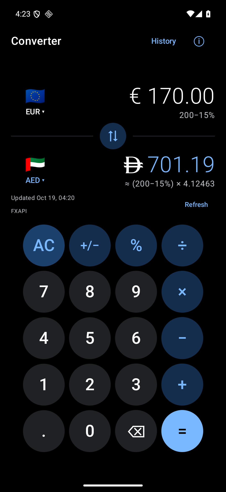
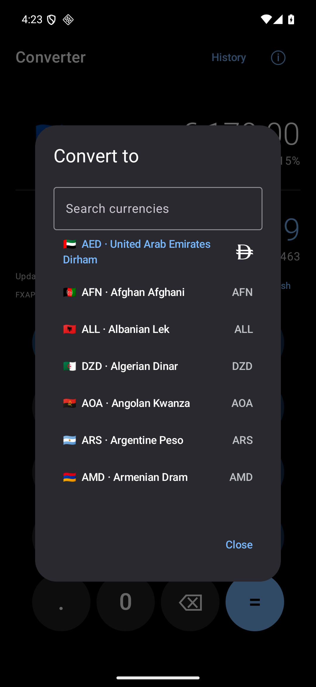
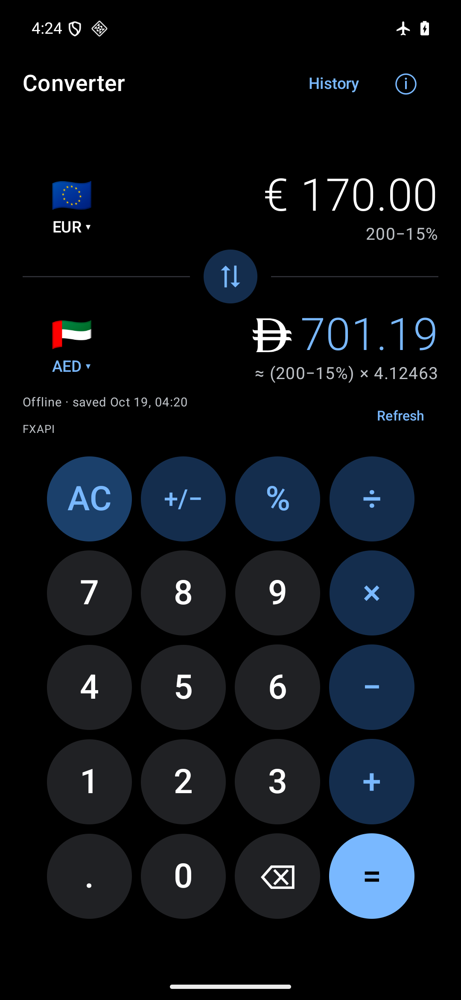
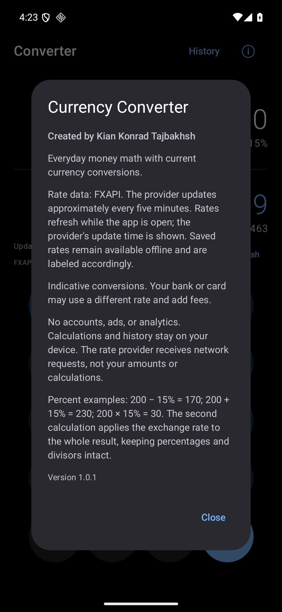

# Currency Converter

A native Android currency converter with a pitch-black interface, blue accents, round keys, and money calculations. Created by **Kian Konrad Tajbakhsh**.

[Download the APK](https://github.com/Kian-hdr/currency-converter-android/releases/latest) · [Build from source](docs/BUILD.md) · [Privacy](PRIVACY.md) · [MIT license](LICENSE)

## What it does

- Shows both currencies together, with flags, symbols, amounts, and the conversion calculation.
- Supports addition, subtraction, multiplication, division, sign changes, percentages, discounts, markups, and bill splitting.
- Converts immediately as you type. Online rate snapshots come from FXAPI, which publishes updates approximately every five minutes.
- Keeps the last successful rate table for offline use. Saved/stale status and provider update time stay visible; reconnecting triggers a refresh.
- Includes searchable supported fiat currencies, a centered swap control, local history, and optional system-controlled key haptics.
- Uses the UAE’s new official dirham symbol, including on phones whose fonts do not yet support it.
- Selects an original white launcher icon when Whicons is installed, and the normal blue/white icon otherwise. Launcher caches and active icon-pack settings remain controlled by the launcher.

Android 9 or newer (API 28+). Built and tested for Samsung Galaxy S25 Ultra running Android 16. No account, ads, analytics, or API key required.

## Screenshots

Actual version 1.0.1 app captures from an Android 16 emulator, not mockups.

| Converter | Currency selection |
|---|---|
|  |  |
| Offline mode | About and creator |
|  |  |

## Install

1. Download `Currency_Converter_v1.0.1.apk` from [Releases](https://github.com/Kian-hdr/currency-converter-android/releases).
2. Open it on your Android phone. Allow installation from your chosen browser or file manager if Android asks.
3. Open Currency Converter with an internet connection once to download rates. After that, the saved table is available offline.

Updates use the same package and signing identity. Installing an update preserves local preferences and history. The release includes a SHA-256 checksum for download verification.

## Money math

`200 − 15% = 170` · `200 + 15% = 230` · `200 × 15% = 30` · `120 ÷ 3 = 40`

The second calculation applies the exchange rate to the whole result, keeping percentage and bill-split semantics intact. Amounts round for display according to the currency; the calculation engine uses decimal arithmetic. Indicative conversions can differ from bank/card rates and fees.

## Rates and privacy

Data provider: [FXAPI](https://fxapi.app/). Network requests retrieve a USD-based rate table; currency pairs, amounts, and calculations stay on the device. Rates are provider snapshots, not a tick-by-tick trading feed. The app checks while foregrounded and preserves the provider timestamp when saving offline data.

First launch needs a connection for exchange rates. Arithmetic remains available without one. See [PRIVACY.md](PRIVACY.md) for storage and network behavior.

## Development

Kotlin and Jetpack Compose. [Build and signing instructions](docs/BUILD.md) cover debug, tests, lint, and locally signed release APKs. The test suite contains 35 unit tests plus native device integration coverage for money calculations, real rate conversion, history, state restoration, AED rendering, stationary swap layout, and creator attribution.

Original application code is released under the [MIT license](LICENSE). Official currency-symbol assets and dependencies retain their respective rights; see [NOTICE.md](NOTICE.md).
